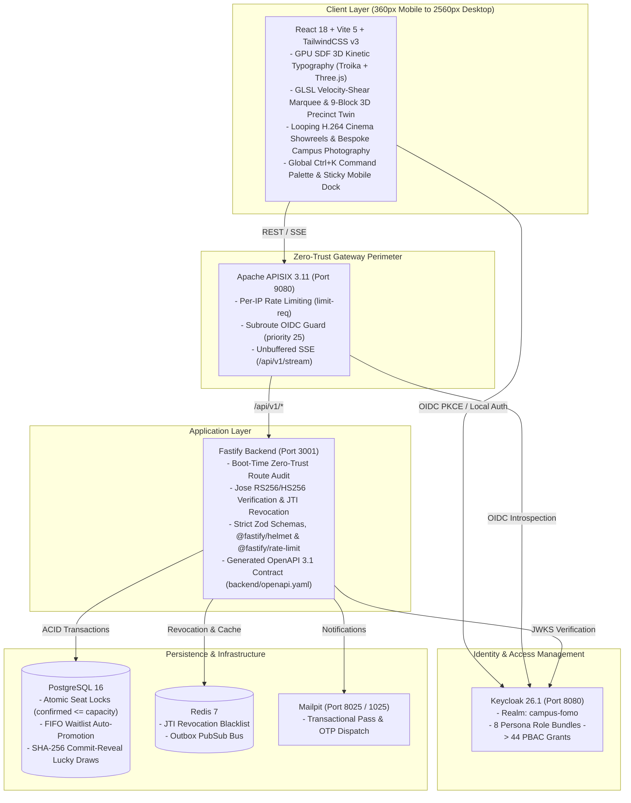

# CONCOURSE // Campus FOMO — CHRIST University Central Campus

> **Zero-Trust Campus Event Operating System, WebGL 3D Precinct Twin & Rotating HMAC Gate Passes**  
> Engineered for **CHRIST (Deemed to be University) — Central Campus, Hosur Road, Bengaluru** (`12.9345 N · 77.6060 E`) in 100% compliance with the _CampusFest Student Handbook (15 Oct 2026)_.

---

## 1. Architecture Overview

CONCOURSE (`Campus FOMO` v3) enforces an enterprise **Zero-Trust** perimeter. External traffic ingresses through **Apache APISIX 3.11** (rate limiting, CORS allowlist, and OpenID Connect Bearer verification against **Keycloak 26.1**). The **Fastify 4** backend re-verifies JWT signatures (`jose`), enforces **44 atomic permission scopes (PBAC)** plus organizer ownership and departmental boundaries, validates every request with **Zod**, and guarantees atomic seat reservations and SHA-256 commit-reveal lucky draws.



---

## 2. Highlights & Key Capabilities

- **v3 Anodized Matte Carbon & Kinetic Editorial UI**: Built on `#07090D` Void, `#101620` Carbon, `#F4F0E6` Titanium Bone, `#FF4D1C` Molten Vermilion, `#E2B45A` Champagne Gold, and `#2EE59D` Telemetry Phosphor with self-hosted `Syne`, `Space Grotesk`, `Outfit`, `Chakra Petch`, and `JetBrains Mono`. Zero emojis; 100% custom vector SVGs & geometric icons.
- **AAA WebGL + Cinema Video Showreels**:
  - **GPU SDF 3D Kinetic Hero Typography** (`WebGLKineticHeroText.tsx`) with custom GLSL vertex wave displacement and progressive zero-CLS Core Web Vitals hydration.
  - **9-Block Interactive 3D CHRIST Precinct Twin** (`CampusPrecinct3DMap.tsx`) mapping _Central Block_, _Main Auditorium_, _K.E. Auditorium (Block IV)_, _Central Quadrangle_, _Birds Park Amphitheatre_, _Block II Lab_, _Floodlit Turf_, _Devadan Block_, and _Third Wave Roastery_ (also available inside `/app/map`).
  - **Seamless Local H.264 `.mp4` Cinema Reels** (`christ-concourse-reel.mp4`, `blossoms-stage-loop.mp4`) + 6 bespoke Central Campus photographs with `prefers-reduced-motion` static poster fallback and WCAG Play/Pause controls.
- **Pure Permission-Based Access Control (PBAC)**: Routes and UI screens check atomic permission strings (`event:approve:dept`, `checkin:scan:own-event`, `rbac:manage`), never role names. External participant isolation is derived via `isExternalParticipantScope(permissions)`.
- **High-Contention Concurrency & Cryptographic Integrity**:
  - **50-Way Last-Seat Race Tested**:Deterministic mutex/row-lock engine guarantees `confirmedCount <= capacity` and automatic `#1` waitlist promotion on cancellation.
  - **30-Second Rotating HMAC-SHA256 Gate Passes**: Defeats screenshot sharing with `<180ms` optical/token gate verification and first-name-only zero-PII scanner output.
  - **Commit-Reveal Lucky Draws**: Pre-published SHA-256 seed hash with public post-draw mathematical verification (`/api/v1/luckydraw/campaigns/:id/verify`).

---

## 3. Repository Layout

```text
Campus-Fomo/
├── backend/                   # Fastify 4 + TypeScript strict API & OpenAPI source of truth
│   ├── openapi.yaml           # Generated OpenAPI 3.1 contract
│   ├── scripts/               # OpenAPI generator & Keycloak PBAC sync scripts
│   └── src/
│       ├── access/            # 44 permissions, 8 role bundles, PBAC screen synthesizer
│       ├── auth/              # Jose JWT verification & Zero-Trust boot-time route audit
│       ├── contracts/         # Zod schemas & RFC 7807 Problem Details registry
│       ├── domain/            # Events, registration, rotating QR check-in, lucky draw, SSE
│       └── modules/           # Health, auth, /me, audit, and RBAC governance routes
├── frontend/                  # Vite 5 + React 18 + TypeScript + Three.js + TailwindCSS
│   ├── public/
│   │   ├── fonts/             # Self-hosted WOFF fonts for Troika WebGL SDF text
│   │   ├── media/             # 2 seamless H.264 .mp4 reels + 6 campus photographs
│   │   ├── favicon.svg        # Vector CHRIST Concourse shield icon
│   │   ├── robots.txt         # Search crawler directives
│   │   ├── sitemap.xml        # Canonical XML sitemap
│   │   └── site.webmanifest   # Progressive Web App manifest
│   └── src/
│       ├── api/               # Typed REST client & deterministic offline fallback
│       ├── auth/              # Session context, token refresh, permission helpers
│       ├── components/        # WebGL canvases, CinemaVideoFrame, CommandPalette, Shell
│       └── pages/             # LandingPage, LoginPage, SignupPage & 11 PBAC workspace views
├── infra/                     # Docker Compose (Keycloak 26, APISIX 3.11, PG 16, Redis 7, Mailpit)
├── docs/                      # Complete Stage 1–7 Handbook & Audit Documentation
└── scripts/                   # Append-only AI-LOG check & full monorepo verify runner
```

---

## 4. Quick Start

### Option A — Instant Local Full-Stack Mode (Zero Docker Required)

```bash
# 1. Install workspace dependencies (pnpm v12+)
pnpm install

# 2. Start Fastify Backend (http://localhost:3001) & Vite Frontend (http://localhost:5173)
pnpm dev

# 3. Run full contract, typecheck, unit, concurrency & production build verification
pnpm verify
```

### Option B — Full Containerized Zero-Trust Stack (Keycloak 26 + APISIX + Postgres 16 + Redis 7)

```bash
cp .env.example .env
pnpm infra:up
pnpm --filter campus-fomo-backend seed:reset
pnpm dev
```

---

## 5. Provisioned Evaluator Personas (8 Scoped Roles)

In non-production environments (`NODE_ENV !== "production"`), open **`http://localhost:5173/login`** and use the **1-Click Evaluator Persona Drawer** (or request a local dev OTP passcode) to inspect any of the 8 permission-scoped workspaces without hardcoding credentials in documentation:

| Persona                 | Identifier                      | Default Role Bundle | Primary Permission Scope                                      |
| :---------------------- | :------------------------------ | :------------------ | :------------------------------------------------------------ |
| **CHRIST Student**      | `asha@christuniversity.in`      | `STUDENT`           | Discover, atomic seat booking, watchlist, XP league, draws    |
| **External Fest Guest** | `priya.menon@pes.edu`           | `GUEST`             | External-open inter-collegiate fests & Gate-1 pass            |
| **Student Event Head**  | `rohan@christuniversity.in`     | `EVENT_HEAD`        | Proposal studio, monsoon backup, volunteers, broadcasts       |
| **Gate QR Marshal**     | `volunteer@christuniversity.in` | `VOLUNTEER`         | Sub-300ms rotating HMAC gate scanner (zero-PII display)       |
| **Faculty Coordinator** | `dr.nair@christuniversity.in`   | `FACULTY`           | Stage-1 departmental endorsement & `<150ms` clash check       |
| **Dean of Students**    | `dean@christuniversity.in`      | `DEAN`              | Stage-2 INR budget sanction & live concourse publication      |
| **Campus Partner**      | `sponsor@thirdwavecoffee.in`    | `SPONSOR`           | Third Wave Coffee showcase & aggregated zero-PII analytics    |
| **OITS Administrator**  | `admin@christuniversity.in`     | `ADMIN`             | 44-permission PBAC matrix, direct grants, audit & ops console |

---

## 6. Documentation & Handbook Stage Index

- [docs/REQUIREMENTS.md](docs/REQUIREMENTS.md) — Stage 1 Story Cards, measurable acceptance criteria & MoSCoW matrix.
- [docs/AI-LOG.md](docs/AI-LOG.md) — Stage 2 strictly append-only engineering & `[AI-WRONG]` audit log.
- [docs/ARCHITECTURE.md](docs/ARCHITECTURE.md) — Stage 3 system topology, OpenAPI contract flow & ADRs.
- [docs/TEST-PLAN.md](docs/TEST-PLAN.md) — Stage 4 5-class test design (Normal, Boundary, Edge, Concurrency, Failure).
- [docs/CHANGE-REQUESTS.md](docs/CHANGE-REQUESTS.md) — Stage 5 Change-Request impact analysis & regression log.
- [docs/RELEASE-AUDIT.md](docs/RELEASE-AUDIT.md) — Stage 6 security, PII redaction, licence & supply-chain sign-off.
- [docs/ESTIMATION.md](docs/ESTIMATION.md) — Stage 7 PERT three-point & COCOMO II schedule estimation.
- [docs/DESIGN-SYSTEM.md](docs/DESIGN-SYSTEM.md) — v3 visual tokens, typography, WebGL shaders & cinema media architecture.
- [docs/LIGHTHOUSE-AUDIT.md](docs/LIGHTHOUSE-AUDIT.md) — Real Chrome Headless Lighthouse Desktop & Mobile performance, accessibility, best-practices & SEO audit report.
- [docs/HANDBOOK-COMPLIANCE.md](docs/HANDBOOK-COMPLIANCE.md) — Complete 7-stage compliance matrix.
