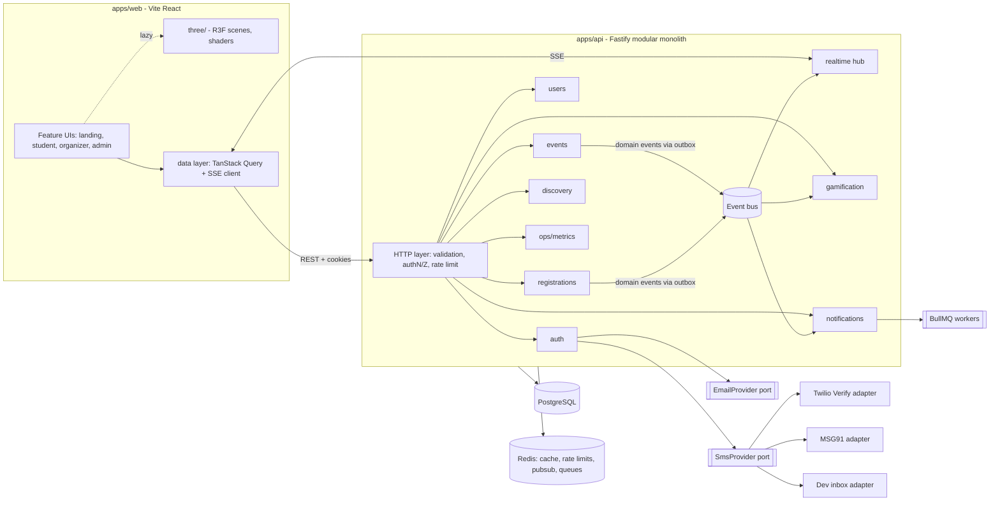

# Architecture — Campus FOMO

Principle (Parnas): **hide each decision likely to change behind one module.** What changes: SMS provider, email provider, ranking algorithm, 3D scenes, DB vendor, realtime transport, payment (future).

## 1. System view



**Modular monolith first** (4 students, 1 deployable, clear module seams). A module may be extracted to a service later because it only talks through its `index.ts` interface and domain events. This is ADR-001.

## 2. Backend module rules

- `modules/<name>/{index.ts (public API), routes.ts, service.ts, repo.ts, schema.ts, events.ts, *.test.ts}`.
- Routes → service → repo. Services never import another module's repo; they call its public interface or publish a domain event.
- Ports and adapters for anything external (SMS, email, clock, id generator, storage).
- **Transactional outbox:** state change + `outbox_events` row in one DB transaction; a relay publishes to Redis pub/sub → realtime hub, notifications, gamification. No lost or phantom events.
- Errors: typed domain errors → problem+json with stable `code`.

## 3. Data model (PostgreSQL, Drizzle migrations)

`users`, `credentials`, `user_roles`, `refresh_tokens(family_id, used_at, revoked_at)`, `otp_challenges`, `profiles(dept, year, interests[])`, `clubs`, `club_members`, `venues`, `events(status, version, starts_at, ends_at, capacity, confirmed_count, tsv)`, `event_tags`, `registrations(status CONFIRMED|WAITLISTED|CANCELLED, waitlist_pos, UNIQUE(event_id,user_id))`, `checkins(UNIQUE(registration_id))`, `bookmarks`, `notifications`, `xp_ledger(UNIQUE(user_id,event_id,kind))`, `badges`, `user_badges`, `audit_log`, `outbox_events`, `idempotency_keys`.
Indexes: `events(status, starts_at)`, GIN on `tsv` + `pg_trgm` on title, partial index on PUBLISHED, `registrations(event_id,status,waitlist_pos)`, keyset pagination on `(starts_at,id)`.
**Seat integrity** is enforced twice: conditional `UPDATE events SET confirmed_count = confirmed_count+1 WHERE id=$1 AND confirmed_count < capacity RETURNING ...` inside the registration transaction, and a CHECK constraint `confirmed_count <= capacity`. Waitlist promotion uses `SELECT ... ORDER BY waitlist_pos FOR UPDATE SKIP LOCKED LIMIT 1` in the cancel transaction.

## 4. API surface (all under `/api/v1`, schemas in `packages/contracts`)

| Area         | Endpoints                                                                                                                                                |
| ------------ | -------------------------------------------------------------------------------------------------------------------------------------------------------- |
| Auth         | `POST /auth/signup`, `/auth/otp/request`, `/auth/otp/verify`, `/auth/login`, `/auth/refresh`, `/auth/logout`, `/auth/logout-all`, `/auth/phone/change/*` |
| Me           | `GET/PATCH /me`, `GET /me/registrations`, `/me/bookmarks`, `/me/xp`                                                                                      |
| Events       | `GET /events` (filters, q, cursor), `GET /events/:id`, `POST /events`, `PATCH /events/:id`, `POST /events/:id/submit                                     | cancel`, `GET /events/:id/attendees`, `GET /events/:id/qr` |
| Registration | `POST /events/:id/register` (Idempotency-Key), `DELETE /events/:id/register`, `POST /events/:id/checkin`                                                 |
| Approval     | `GET /approvals`, `POST /approvals/:id/approve                                                                                                           | reject`                                                    |
| Admin        | `GET/PATCH /admin/users`, `GET /admin/audit`, `GET /admin/ops`                                                                                           |
| Discovery    | `GET /feed` (server-driven sections), `GET /search/suggest`, `POST /search/nl` (stretch)                                                                 |
| Realtime     | `GET /stream` (SSE; `Last-Event-ID` replay)                                                                                                              |
| Health       | `/healthz`, `/readyz`, `/metrics`                                                                                                                        |

## 5. Server-driven "intelligent UI"

`GET /feed` returns a JSON **layout spec**: ordered sections (`hero`, `this_week`, `for_you`, `closing_soon`, `trending`, `because_you_joined`) with item ids and reason strings. The web app renders sections through a **component registry**, so new section types arrive without redesign. Ranking = weighted score in SQL (tag match, recency decay, popularity, seats-left urgency, clash penalty) with a deterministic fallback; Gemini is optional and only parses NL queries into validated filters.

## 6. Frontend architecture

Feature folders; `three/` isolated and lazy-loaded behind `<Scene>` wrapper that owns capability detection (WebGL, tier, reduced motion). Data layer exposes hooks only; 3D receives props, never fetches. Realtime events patch TanStack Query cache.

## 7. Cross-cutting

Config validated at boot; pino with redaction; Prometheus metrics (HTTP, queue, SMS latency, SSE connections); health/readiness; graceful shutdown; request IDs; audit log for privileged actions; CORS allow-list; Helmet + strict CSP; compression; ETags.

## 8. Scaling notes (production has millions of moments, demos have one)

Stateless API instances behind LB; SSE fan-out through Redis pub/sub; read-heavy feed cached 5–15 s per filter-hash with stampede protection and invalidation on outbox events; DB pool sized per instance; slow-query logging; pagination keyset only; queue absorbs notification spikes; load shedding returns 503 + Retry-After on overload.

## 9. ADR log (append here; template)

```
ADR-00N: <title>
CONTEXT: ...   OPTIONS: A) B) C)   DECISION: we chose X because ...
CONSEQUENCES: Easier: ...  Harder: ...   PRINCIPLE: modularity | information hiding | separation of concerns
```

- ADR-001 Modular monolith over microservices. ADR-002 SSE over WebSocket (one-way push, proxy friendly, replay via Last-Event-ID). ADR-003 Outbox over dual-write. ADR-004 SQL-side ranking. ADR-005 Vite SPA over Next.js (WebGL-heavy, no SEO need beyond landing, which is pre-rendered static). ADR-006 Provider-agnostic SMS port.
